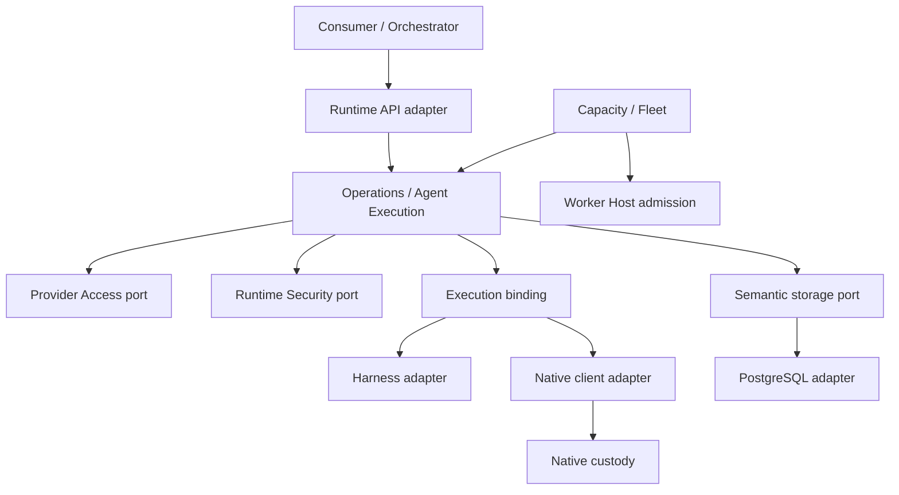

# Agent Runtime Greenfield Foundation Plan

## Purpose

**Цель: с нуля построить модульный runtime технического исполнения агентов, который можно встроить как библиотеку, собрать из независимых компонентов и развернуть от одного исполнителя до квалифицированного fleet с десятками тысяч одновременно активных операций.** Рост функций и команд разработки не должен превращать ядро в общий менеджер всех подсистем.

Это проект целевой архитектуры и последовательности доставки. `active` в метаданных означает поддерживаемый план, а не принятие новых ADR, завершение реализации или подтверждение производительности. Базовый исследованный HEAD: `518f1449acf6dda793662783ec9d918d4007c563`; дата исследования — 26 октября 2026 года. Работа ведётся в draft PR #235. Новая реализация создаётся сразу в целевых границах; полезные контракты, поведенческие тесты и неизменяемые решения сохраняются.

Документ читается вместе с:

- [исходным планом v3 и S1–S5](agent-runtime-architecture-program-plan.md), который задаёт первый ограниченный ordinary-срез;
- [принятым архитектурным фундаментом](architecture-foundation.md), [моделью поколений](execution-generation-model.md), [границами коммуникации](communication-boundaries.md) и ADR, которыми они уточнены;
- [существующим планом capacity admission](capacity-admission-delivery-plan.md), который остаётся владельцем C0–C3;
- [исследованием индустрии](../spikes/agent-runtime-industry-architecture-research.md): первичные источники, подтверждённые исторические ошибки, ограничения и применимые уроки;
- [решениями и протоколом пересмотра](agent-runtime-foundation-decisions-and-review.md): альтернативы, оценки, вопросы владельцу и результаты критики.

**Порядок авторитетности:** принятые ADR и закреплённые стандарты → действующие профили → принятый контракт конкретного среза → этот план и исследовательские рекомендации. При конфликте требуется явный successor соответствующего решения. Этот документ не меняет frozen contained-turn, не принимает динамические плагины и не передаёт native-custody другой команде. Будущий fleet, sessions и новые harness рассматриваются здесь заранее, но их реализация имеет собственные завершённые срезы.

## 1. Проверяемые преимущества

«Лучше других» — цель развития, а не установленный результат исследования. Сравнивать нужно одинаковые гарантии, workload и deployment. Число пакетов, Rust, диаграммы и количество агентов сами по себе не доказывают качество.

| Преимущество, которое хотим получить | Архитектурное решение | Как подтвердить |
| --- | --- | --- |
| Замена целого агентного движка без переписывания lifecycle | Whole-harness binding отдельно от model provider, протокола и среды | Контрактный набор и независимый контрпример без Codex/PID; реальный второй harness только при его продуктовой доставке |
| Компоненты полезны вне нашего продукта | Библиотеки механизмов с узкими публичными входами, без импортов Host/контекстов | Установка опубликованного tarball в обычный disposable-проект, реальные consumers, отсутствие скрытой инфраструктуры |
| Предсказуемое поведение при перегрузке | Конечные count/byte/resource budgets от ingress до cleanup | Burst, медленный storage, pending acquisitions, cancel storm; известные отказы и сохранение control progress |
| Честное восстановление | Durable identity до эффекта; uncertainty и cleanup debt сохраняются | Потерянные ACK, сбой между эффектом и записью, restore/fencing, отсутствие автоматического повторного эффекта |
| Рост кода без общего центра изменений | Semantic owners, feature slices, consumer-owned ports, автоматические границы | Изменение одной интеграции не меняет чужие domain/use cases; публичный граф без циклов и deep imports |
| Разные deployments без двух продуктов | Одинаковые semantic contracts, отдельные local/remote adapters и qualification profiles | Один набор смысловых сценариев; отдельная проверка реального transport, отказов и изоляции |
| Обновления без потери обязанностей | Раздельные API/schema/profile/release identities и recovery horizon | Mixed-version reader/writer, drain, rollback, retained cleanup path |

Ограничиваем feature scope раньше, чем ослабляем выбранную гарантию. Эти критерии согласуются с [Engineering Quality Standard](https://github.com/agent-teams-ai/.github/blob/main/docs/engineering-quality-standard.md#early-product-advantage). Исследование не является исчерпывающим аудитом технического долга всех конкурентов и не утверждает, что перечисленные исторические дефекты сохраняются у них сегодня.

## 2. Единицы модели и масштаба

| Термин | Смысл и владелец | С чем нельзя смешивать |
| --- | --- | --- |
| Logical agent | Идентичность/роль агента в продукте потребителя | Процесс, tenant, одна операция |
| Runtime session | Логическая техническая сессия; Agent Execution по принятой модели | Provider session ID и время жизни процесса |
| Runtime operation | Принятый технический intent и его durable результат; semantic owner Agent Execution | Бизнес-задача, транспортное сообщение, workflow |
| Execution generation | Период исполнения с конкретной authority; Agent Execution | Retry, ОС PID, версия npm-пакета |
| Dispatch/attempt | Техническая попытка в конкретном профиле; внутренний dispatch record | Универсальный новый aggregate `ExecutionAttempt` |
| Harness | Целый агентный цикл: reasoning/tool loop, собственная история и протокол | Только клиент LLM |
| Model provider | Вызов модели внутри harness | Управление процессом, сессией и durable runtime |
| Environment/custody target | Process/container/VM/remote target с отдельным владельцем ресурсов | Политика агента и доказательство разрешения |
| Host/worker | Конкретная сборка и lifecycle локальных capabilities | Глобальный scheduler и бизнес-оркестратор |
| Tenant/account | Границы изоляции/учёта потребителя и provider account | Произвольные поля из prompt или provider DTO |
| Reader/subscription | Потребитель output/observation с собственным бюджетом | Источник истины о завершении |

Основание терминологии: [принятая модель](execution-generation-model.md) и [границы коммуникации](communication-boundaries.md). Bounded ordinary-профиль не превращается в многочасовой session runtime простым увеличением timeout. Для session continuity нужны отдельные binding, authority, compatibility и recovery contracts.

Каждый capacity claim указывает, что именно посчитано: например, 10 000 dormant sessions, 10 000 принятых queued operations или 10 000 одновременно работающих изолированных процессов. У одного агента может не быть resident process; один квалифицированный runtime может обслуживать несколько последовательных операций. Совместное размещение tenant/session/credential generations допускается только выбранным квалифицированным профилем, а не ради красивой плотности.

## Ownership boundary

## 3. Карта ответственности

Сохраняем ровно четыре accepted bounded contexts: **Agent Execution, Provider Access, Runtime Security, Runtime Configuration**. Ordinary Operations — самостоятельная библиотека механизма в semantic ownership AE, а не пятый context; Host, storage adapter, native custody, projections и deployment capabilities ниже также не объявлены новыми доменными контекстами. Будущие возможности имеют место заранее, но не считаются уже реализованными.

| Владелец | Его состояние и решения | Запрещённое смешение | Статус/следующий срез |
| --- | --- | --- | --- |
| Ordinary Operations (механизм AE) | Acceptance, identity/fingerprint, operation state, claim, cancellation, receipt/readback semantics | SQL, provider DTO, process supervision, бизнес-workflow | S2, отдельная reusable library |
| Agent Execution | Execution binding, technical session/generation, workspace/artifact policy, effect admission integration | Credentials, чужие grants, teams/tasks, общий scheduler в engine | S4; sessions отдельным successor-срезом |
| Provider Access | Credential custody/generation, provider access, broker route, refresh, account budget policy | Общая operation state machine, глобальные бизнес-бюджеты | S3; fleet account budgets как следующая capability |
| Runtime Security | Authorization, workspace/trust/capability/egress decisions, recorded grant limits | Provider token refresh, process cleanup | S3; hostile tenancy имеет отдельный профиль |
| Runtime Configuration | Нечувствительные immutable profile definitions, revisions, provenance | Secret store и runtime mutable service bag | Сохраняем текущую владельческую границу |
| Host | Выбор проверенных releases, одна composition, local admission, lifetime/readiness/retirement | SQL, протокольный интерпретатор, domain workflow, второй resolver | S5 |
| Storage adapter | IO, locks/CAS, transaction outcomes, schema/migration verification | Решения домена, скрытые retries, закрытие borrowed pool | Первый ordinary S2 — PostgreSQL; broader foundation сохраняет SQLite local/desktop + PostgreSQL hosted |
| Native lane | Физическая custody keeper/init, native protocol/client/artifacts, autonomous deadlines | Продуктовые PA/RS решения и второй operation journal | Отдельный владелец по NATIVE-INTEGRATION |
| Capacity/fleet capability | Resource-pool truth, placement/fairness, worker membership и rollout coordination | Право игнорировать operation claim, cancel, PA/RS или повторять unknown effect | C0–C3; отдельный context только при независимом lifecycle/ownership |
| Observation/projections | Rebuildable read models, lag/freshness, bounded subscriptions | Authority, canonical output acceptance, permission decisions | OBS-ADOPT и конкретные readers |
| Consumer/orchestrator | Teams/tasks/workflow, product priority mapping, approvals UX, продолжение работы | Прямые записи private runtime tables и управление native handles | За пределами runtime, через публичные порты |

Диаграмма показывает направления взаимодействия через порты, а не разрешение application-коду импортировать реализации. Composition находится снаружи и связывает конкретные adapters. Fleet не получает право напрямую менять private tables Operations; PA/RS остаются отдельными authorities.

### 3.1 Clean Architecture, SOLID, DDD и DRY в конкретных правилах

1. **Контекст отвечает за смысл и транзакционные инварианты.** Feature отвечает за цельную capability. Package отвечает за независимое потребление/доставку. Process отвечает за failure/trust boundary. Эти четыре разбиения не обязаны совпадать.
2. Domain и application не импортируют ORM, transport/provider DTO, Node IO, Host или Get Modular. Outbound port объявляется потребителем; adapter переводит чужой язык в его контракт.
3. Один владелец state, mutation и lifecycle; borrowed dependency не закрывается потребителем. Cleanup callback completion не доказывает физическое освобождение.
4. Узкий capability вместо `RuntimeServices`, `BaseAgent`, `AgentManager`, generic repository или универсального event bus. Ошибки, timeout, cancellation, ownership и unsupported-поведение входят в контракт наравне с happy path.
5. Liskov проверяется по гарантиям: adapter не возвращает фиктивный PID, ложный drain, успешный no-op для unsupported capability или более слабую изоляцию под прежним profile.
6. DRY применяется к одному знанию и одному владельцу. Независимые контексты не соединяются shared-domain пакетом ради нескольких похожих структур. Независимый test oracle не генерируется из той же таблицы, которую проверяет.
7. Public surface минимален; type-only deep import тоже нарушает границу. Domain model, public DTO, wire DTO и persistence record разделяются там, где различаются семантика/валидация; бессмысленные копирующие mapper-слои не добавляются.
8. Малые helpers и fixed library dependencies остаются обычными imports/factories. Assembly entries появляются для реальных independently assembled/replaceable capabilities, а не для каждого parser, класса или файла.

Форма feature, visibility вложенных features, production size limits, descriptors и wiring oracle определяются принятым [FMS/CMS profile](get-modular-adoption.md), а не этой таблицей. Feature card описывает purpose, parent, публикуемые/потребляемые capabilities, growth/split signals. Файлы и пустые директории «на будущее» не создаются.

### 3.2 Рост большой кодовой базы

У каждого поддержанного заменяемого capability есть owner, контракт, необходимые conformance cases и понятная failure model; public implementer audience проверяется отдельно от обычного SDK caller. Новый integration adapter должен добавляться локально; если для этого меняются unrelated contexts, граница пересматривается. Общие registries генерируются из одной владельческой декларации и проверяются на drift; не поддерживаем несколько вручную синхронизируемых каталогов.

При росте измеряем change fan-out, время focused checks, размер публичных деклараций, количество циклов/исключений и сложность composition. Миллион строк — сценарий организации кода, а не целевой объём. Разделяем feature, когда у неё появляются независимые причины изменения, политики, владельцы или lifecycles. Split по числу строк без смысловой границы лишь переносит связанность в imports.

## 4. Библиотеки как независимые компоненты

**Библиотечная форма выбирается сразу, когда известна повторно используемая ответственность.** Не требуется сначала размножить реализацию в двух продуктах. Вместе с первым релизом нужны один реальный consumer, disposable external project и доказательство отсутствия скрытой зависимости от нашей организации.

| Компонент | Самостоятельная польза | Что остаётся вне него | Решение |
| --- | --- | --- | --- |
| JSONL framing/strict decode | Bounded byte framing, UTF-8, duplicate keys, EOF/error semantics | Provider methods, secrets policy, process lifecycle | S1 library |
| Codex protocol/session/turn mechanism | Типизированный session/protocol reducer, correlation и uncertainty | Разрешение эффектов, credentials, runtime operation policy | S1 library поверх JSONL |
| Native generic client | Контракт keeper/init с transport и custody observations | Runtime profile policy, SQL, prompt/task semantics | Потреблять отдельную native-owned поставку |
| Ordinary Operations | Durable one-shot operation lifecycle через consumer-owned ports | Конкретный DB/harness/process/Host | S2 library; не универсальный workflow engine |
| PostgreSQL runtime storage | Конкретные semantic stores, миграции и verified storage bundle | Решение retry/ownership, raw pool в Host API | S2 library; не обещать автоматическую смену любой БД |
| Filesystem Custody | Уже выделенная техническая custody | Workspace business policy и второй journal | Сохранить существующий owner/implementation |
| Composition/resources/observation | Готовые независимые механизмы Get Modular | Продуктовый lifecycle, readiness, authorization | Переиспользовать, не создавать свою DI/lifecycle платформу |
| Contract conformance | Проверка реализаций порта без production imports | Secret fixtures, внутренние schemas и product-only tests | S2 storage kit остаётся private; публичные kits только для объявленного implementer API |
| Additional harness/protocol adapters | Повторно используемая интеграция конкретного agent engine | Teams/tasks и общая conversation schema | Отдельно при первом реальном consumer |
| Remote execution adapter | Доставка/verification по выбранному worker protocol | Право самостоятельно повторять uncertain effect | После local baseline, до fleet qualification |
| Capacity policy kernel | Детерминированный механизм только при совпадающей семантике consumers | Tenant policy, SQL, worker supervision | Условное выделение; capacity owner существует и без отдельного npm-пакета |
| Public SDK и Host entrypoint | Embed/API surface, curated types, explicit storage/lifecycle | Все пакеты через общий barrel, raw ORM, internal composition | S5; самостоятельно понятные установки и presets |

S1/S2 уже определяют конкретные предварительные package identities и exports. Новые универсальные имена должны описывать назначение; этот план не переименовывает опубликованные пакеты. Изменение предварительных имён согласуется один раз до публикации, без parallel aliases. Native repository/package names берутся из реальной поставки владельца.

Порты и типы, необходимые для использования **публичной factory**, с первого релиза являются поддержанным implementer contract этого package/profile. Их semantics, failure/lifetime и intentional 0.x breaking changes документируются; packed consumer отдельно компилирует caller и реализацию обязательных ports, а существующие независимые cases проверяют её существенные гарантии. Вопрос об ecosystem support не откладывает уже выбранный S2 `./composition`. Это не делает все внутренние ports публичными и не требует публикации private joined conformance suite.

Каждая public library имеет: README «когда использовать/когда не подходит», ownership/lifetime, supported runtime/profile, exact public exports, typed errors, bounded defaults, licensing/provenance, migration notes и compiled usage examples. Import не читает environment, не открывает DB/network и не запускает process. Consumer передаёт нужные capabilities явно. Package installation не требует organization credentials, нашего каталога tenants или нашего deployment.

Пакетирование не равно архитектуре: допустим monorepo, если public tarball используется независимо. Отдельный repository нужен по независимой поставке/владению, а не для изображения слабой связанности. Изменения библиотек проходят public-surface/typecheck, packed consumer и behavioral contract suite. Не строим вторую реализацию storage/harness только для количества.

### 4.1 Поддерживаемые способы сборки

| Сборка | Что подключает потребитель | Гарантия, которую нельзя автоматически переносить |
| --- | --- | --- |
| Только JSONL или provider protocol | Один механизм, собственный transport | Не получает operation durability, security или custody |
| Embedded bounded runtime | Operations + owner ports + выбранный Host/store/binding | Не получает remote failover и hostile tenancy |
| Local managed worker | Embedded runtime + реальный native tuple + finite admission | Не получает fleet-wide quotas только из local limits |
| Multi-worker self-hosted fleet | Предыдущие capabilities + durable delivery/capacity + exact deployment profile | Не получает 10k qualification из числа replicas |
| Hosted hostile-tenant service | Fleet + авторизованный trust/isolation/credential/network profile | Не получает безопасность от контейнера или tenantId в payload |

## Invariants

## 5. Контракты, которые фиксируем до реализации зависимых срезов

| ID | Решение фундамента | Владелец / первая проверка |
| --- | --- | --- |
| F01 | Agent/harness, protocol, model и environment — разные оси замены | AE/S1/S4; отсутствие provider DTO в core |
| F02 | Operation acceptance, dispatch, execution, output drain и resource release — отдельные факты | Operations/S2; independent transition cases |
| F03 | Durable effect identity до каждого attempt-owned native эффекта, включая preparation | Native integration; crash-before/after ACK |
| F04 | Unknown outcome сохраняется; retry не следует из timeout/connection loss | Operations/PA/adapter; lost-response cases |
| F05 | Вместимость будущей owned obligation резервируется до durable acceptance | Host/Operations; burst + delayed acceptance + close |
| F06 | Очереди/buffers и resource obligations, принимаемые runtime во владение, имеют конечный envelope; actual IO waiter живёт до settlement/dequeue | Host/store/native; timeout waves и late completion |
| F07 | Control/cleanup имеют отдельную ограниченную возможность прогресса при saturation | Host/capacity; cancel/retire/settle под смешанной нагрузкой |
| F08 | Любое admitted durable state читается своим форматом и вмещает правдивое завершение | Codec/store; encoded-byte и terminal-growth vectors |
| F09 | Locator/correlation ID не является правом доступа; live-cache path проверяет того же caller | API/Host/native; cross-owner lookup/control |
| F10 | Capability support, implementation compatibility и permission — три разных решения | Host/profile/PA/RS; mismatch и unauthorized cases |
| F11 | Source occurrence, reconstructed history, runtime/reader cursor и provider session identity не взаимозаменяемы | Adapter/output; reconnect, duplicate, gap, reader-state loss |
| F12 | Lease/membership/routing не доказывают fencing физического эффекта | AE/capacity/native; stale paused worker |
| F13 | Package SemVer, Published Language/API, capability revision, wire version, durable format и profile/release — отдельные identities | Owners; mixed-version and rollback cases |
| F14 | Нельзя удалить последний совместимый recovery/cleanup path при unresolved obligations | Release/storage/native; retirement with debt |
| F15 | Shared quotas и pools имеют явный scope и суммируются across replicas | PA/storage/deployment; shared-account mixed load |
| F16 | Tenant authorization происходит до live/cache/remote paths, а tenant binding берётся из trusted context | API/RS; hostile caller tests |
| F17 | Runtime остаётся техническим исполнителем; business workflow/retry/priority mapping принадлежит consumer | Architecture review и forbidden dependency fixtures |
| F18 | Любой заявленный scale/security/recovery envelope привязан к exact tested tuple | Qualification owner; evidence record |

F01–F18 — выбранные проектные требования для соответствующих срезов. Таблица не означает, что все они новые: большая часть продолжает действующие protections. Матрица ниже связывает конкретные дополнения с v3 и существующими планами.

### 5.1 Замена whole harness

Минимальный binding описывает поддержанный профиль исполнения, принимает neutral operation/session references и owner-granted capabilities, выдаёт ограниченные observations и точные outcomes. Нельзя требовать `spawn`, PID, stdin/stdout, локальный каталог или одинаковую историю от каждого допустимого harness. Конкретный process profile вправе требовать эти факты; universal Operations engine не вправе распространять их на все профили.

Не вводим единый `AgentMessage` для всех reasoning traces, tools, multimodal output и histories. Public runtime language содержит только необходимые consumer guarantees. Provider-specific расширение сохраняет owner, schema/version, validation, redaction и разрешённую область; неизвестное расширение не становится разрешением эффекта. Для бинарных/больших данных передаются проверяемые artifact references, а не бесконечные inline bytes.

**Три проверки до разных эффектов:** static graph/profile mismatch отклоняется до construction; peer negotiation может потребовать отдельно разрешённый bounded bootstrap/connection; protected workload/tool effect начинается только после успешной совместимости и PA/RS authorization. Не обещаем узнать capabilities удалённого peer до любого соединения.

Замена означает три разных обещания: **выбор другого harness для новых bindings; совместимое продолжение existing session; явный cross-harness import/export с документированными потерями**. Только первое требуется от bounded среза. Continuation следует принятой AE проверке owner/fence/binding/host/boot continuity; при недоказанной continuity используется установленный successor contract, который не повторяет автоматически уже принятый input. Opaque reference и нормализованные messages сами не обеспечивают lossless migration.

S2/S4 contract review должен попытаться выразить bounded in-process async harness без фиктивных process receipts. Если существующие независимые cases не проверяют эту предпосылку, добавляется маленький structural fixture. Он доказывает отсутствие конкретного лишнего требования, а не совместимость со всеми агентами. Реальный второй harness проходит собственную qualification при доставке его consumer-среза.

### 5.2 Сессии, approvals и остановка

AE уже владеет runtime session/generation по принятой модели. В будущем отдельный session feature хранит binding к opaque provider state и его compatibility/retention, не копирует всю чужую историю в общий aggregate. Session metadata и execution authority сохраняют отдельные revision/consistency boundaries. Resume/fork/reattach/reset — разные capabilities, и unsupported остаётся явным результатом.

AE владеет lifecycle технического permission/elicitation request; RS — разрешением; продукт — UX и бизнес-approval. Решение привязывается к точному request, operation/generation, proposed action/input digest, scope, deadline, consumed/revoked state и policy revision; caller provenance сохраняется через UI, wrapper и durable replay. Signing выбирается по trust boundary, не становится обязательным для каждого trusted callback. Stale/duplicate/mismatched approval не возобновляет устаревшую authority. Waiting не означает, что physical resource уже освобождён. Родитель, ожидающий child, не удерживает все permits, необходимые child; освобождается только ресурс, который действительно больше не занят.

Для connection-owned approval/tool callback профиль отдельно определяет **incarnation и lifetime continuation capability**. AE связывает технический request с конкретным provider interaction occurrence и этой capability, когда она нужна. Durable acceptance решения и подтверждённая delivery/enforcement — разные факты. Смена соединения даже при той же runtime generation не доказывает, что callback ещё существует. После его потери выбранный adapter возвращает unavailable/reconciliation/reissue; safe rebind требует подтверждённого current pending request и того же action binding. Иначе нужен свежий AE request/revision или отказ. Старое корректно подписанное решение не создаёт callback заново, не разрешает повтор accepted input и не одобряет другой recovered request. Это узкий contract конкретного session profile, не общий callback manager. Основание — documented disconnect cleanup в [Letta App Server](https://docs.letta.com/self-hosting/app-server/protocol-lifecycle).

Приёмочный случай G3: connection A выдаёт request; A теряется; connection B восстанавливает ту же runtime generation без старого callback. Позднее валидное approval не вызывает resume/повтор эффекта. Отдельно проверяются reused external ID с новой incarnation, cancel/revoke, late reply и unknown delivery ACK; последний сохраняет uncertainty, а не автоматически повторяет решение.

Cancellation различает caller перестал ждать, durable cancel принят, новые эффекты запрещены, физическое исполнение остановлено, output drained и cleanup завершён. Одно `AbortSignal` не доказывает все эти факты. Shared connection/process отменяет только выбранную область; blast radius мультиплексирования квалифицируется до его разрешения.

## 6. Admission, overload и resource ownership

### 6.1 Что ограничивать

| Бюджет | Count/bytes/resource vector | Owner и release condition |
| --- | --- | --- |
| Ingress / duplicate lookup | Requests, decoded bytes, fingerprint/lookup work | API/Host; до сохранения больших payloads |
| Pending submit | Незавершённые submit и удерживаемые payloads | Host/Operations; реальное settlement, включая uncertainty |
| Accepted obligation | Future owned flight либо явно принятый durable backlog | Operations/capacity; по правдивой terminal/recovery disposition |
| Prepare/run/close | Process/container, CPU, RAM, file descriptors, workspace bytes, helpers | Host/native; доказанное освобождение либо retained debt |
| Storage | Connections, actual pending acquisitions, query/lock bounds, retained bytes | Store + pool owner; acquisition/dequeue settled |
| Provider/account | Concurrent requests, tokens/RPM/TPM/spend policy и refresh | PA + deployment; общий account scope across workers |
| Output/readers | Encoded bytes, chunks, in-flight append/read, reader buffers/lag | Output owner/Host; backpressure либо explicit truncation/gap |
| Control/recovery | Cancel/retire/settle, cutoff, reconciliation debt | Соответствующие owners; отдельный bounded reserve |

Вычисляемый верхний предел из нескольких известных caps допустим вместо отдельного лимитера. Требуется конечный envelope, а не обязательный semaphore на каждую строку таблицы. Долг нельзя забыть, чтобы счётчик снова стал зелёным: unresolved custody/debt ограничивает новый admission или получает отдельную enforcement-backed quarantine disposition.

### 6.2 Порядок принятия

Для bounded local-профиля резервируем capacity на будущее владение **до** попытки durable acceptance. Pending semaphore, после которого уже после COMMIT пытаются получить owned slot, оставляет accepted work без вместимости. Передаются reservation и ответственность; duplicate после проверки identity не создаёт второй execution slot. Flood duplicates всё равно ограничен ingress/lookup budget.

`accepted`, `definitely_not_accepted` и `unknown` не смешиваются. Потеря insert ACK или close после успешного acceptance не разрешает ответить «не принято» и не разрешает поздний запуск после закрытия admission. Сохраняем original identity и предписанный профильный путь reconciliation. Базовый S2 запрет automatic readback/retry после unknown claim остаётся в силе.

Для будущего fleet допустим явно принятый bounded durable backlog: тогда операция и обязательство её доставки фиксируются атомарно в владельческой storage boundary. Это отдельный контракт queued acceptance, не молчаливое изменение S2. Очередь имеет владельца quota/count/bytes/expiry/cancel и поддержанный recovery путь; accepted не равен running.

### 6.3 Реальные pool waiters

Timeout вокруг `pool.connect()` не доказывает, что pending acquisition удалён из pool. Token остаётся занят до resolution/rejection underlying acquisition либо доказанного dequeue. Late client не выполняет body и возвращается ровно один раз. Иначе каждая волна timeout создаёт новую скрытую очередь.

Store-local cap не становится global cap при других consumers того же pool. Сумма `pool.max` всех replicas/consumers и headroom для control/maintenance рассматриваются вместе ([node-postgres pool sizing](https://node-postgres.com/guides/pool-sizing)). При DB outage можно гарантировать bounded отказ/debt и независимый physical stop; успешную durable cancellation без DB обещать нельзя.

## 7. Durable state, output и восстановление

### 7.1 Читаемость и запас для завершения

Статический контрпример старого ordinary baseline: validator допускает 2 000 000 UTF-8 bytes output, encoder сериализует без проверки конечного размера, decoder отказывает выше 8 388 608 bytes. Строка из 2 000 000 U+0001 превращается в JSON-строку размером 12 000 002 bytes. Это проверка контрактов и арифметики кодирования, **не воспроизведённый PostgreSQL/Codex incident**; transport cap может исключать именно такую provider trajectory. Новый S2 codec этим фактом не объявляется сломанным.

Требование для новой реализации: encoded UTF-8 envelope проверяется до mutation SQL или имеет доказанный верхний предел. Любое admitted state roundtrips; прежнее state остаётся читаемым после отказа. Output exhaustion не лишает возможности записать cancellation, terminal и bounded reconciliation facts выбранного profile. Достаточен статический запас; отдельный reserve subsystem и физическое разнесение storage не обязательны. Точные пути baseline приведены в исследовательском приложении.

### 7.2 Потоки — четыре разных контракта

1. Provider/source occurrence identity и правило redelivery.
2. Runtime canonical output acceptance и durable sequence/cursor.
3. Live observation/progress с freshness/lag и rebuildable projection.
4. Delivery конкретному reader, его backpressure, cursor expiry и gap.

Одинаковые bytes не означают duplicate occurrence. Runtime revision не является provider cursor. Delivery ACK не доказывает, что эффект выполнен или output полностью drained. Source contract различает **no replay, stable occurrence replay и reconstructed snapshot/history replay**. Для stable replay нужны идентичность occurrence, detection gaps и согласованный durable append. При no-replay потерянные bytes означают неполный drain; reconnect не исправляет факт потери. Unknown append не повторяется автоматически без установленного idempotent contract.

Reconstructed history не становится повтором прежних canonical occurrences по совпадению bytes или session ID. Например, [ACP v2 migration](https://agentclientprotocol.com/protocol/v2/migration) — поверхность v2 остаётся Draft — допускает изменение agent/thought message IDs между reconnect/restart. Такой adapter использует явную snapshot/reset boundary или доказанную mapping семантику; bounded typed snapshot/projection не выдаётся за исходный event stream. Rebuild не заполняет недоказанный gap и не подтверждает complete drain. Приёмочный случай G3: live occurrence A, reconstructed B с тем же содержимым и новое отдельное сообщение с такими же bytes не теряются и не сливаются по text dedup; reader видит reset/snapshot либо проверенное соответствие. Общий conversation schema и второй journal не требуются.

**Resume конкретного reader** связывает cursor с authorized feed/epoch и выбранной representation/schema/transform revision. Для stateful формата контракт называет precondition: сохранённое reducer state, совместимый checkpoint/snapshot, безопасную part boundary или полный replay. После `text-start` → `text-delta` browser refresh может сохранить offset, но потерять открытый part: один offset не делает продолжение читаемым. Между raw/filtered views или версиями cursor нельзя молча переинтерпретировать; нужны explicit resync/gap/refusal либо доказанная translation. Это локальные identities reader contract, не восьмая глобальная version ось и не обязательный checkpoint service. Stateless ordinary reader сохраняет свой узкий контракт. Основание — [Workflow SDK mid-part resumes](https://workflow-sdk.dev/docs/ai/resumable-streams#mid-part-resumes).

Первый structured/transformed resumable reader проверяет mid-part resume с checkpoint и без него, потерю client state, другую representation/version и expiry. `watchSummary` revision не становится output resume cursor. Проверки относятся к реально доставляемому reader/harness срезу; ordinary transport не получает replay capability задним числом.

Slow reader не блокирует cancellation и не удерживает безгранично provider output. Выбранный профиль заранее определяет backpressure/drop/terminate/retain policy; потеря отражается явно. OTel/logging/exporter остаются bounded advisory channels и не становятся источником operation truth.

### 7.3 Transaction, replay, retention

Semantic store port описывает атомарную операцию с identity/revision/preconditions и typed commit outcome. SQL adapter реализует её, не решает domain retries. Row columns, payload, digest, format/profile identities сверяются как одна истина. Long external IO не выполняется внутри transaction/row lock.

Checkpoint или broker ACK не дают exactly-once для внешнего tool/payment/process эффекта. Требуется idempotency у получателя либо отдельный reconciliation/compensation contract; иначе uncertainty сохраняется. Повторная доставка command безопасна только по исходной identity/fingerprint и установленной семантике. Product retry требует разрешённого намерения и свежих budget/authority checks; он не обходит неизвестный предыдущий эффект. Это не универсальный запрет дальнейших technical attempts: accepted [ADR-0002](../decisions/0002-architecture-reconciliation-tenancy-and-operator-recovery.md) и [ADR-0004](../decisions/0004-pre-materialization-dispatch-prevention.md) различают доказанное `known_not_accepted` и unknown, сохраняя semantic effect identity. Более строгий one-shot ordinary остаётся своим профилем. [ADR-0006](../decisions/0006-orthogonal-runtime-operation-state-and-effect-continuity.md) имеет статус proposed и не используется как принятая новая algebra.

Retention больших output/artifacts отделён от retention command/effect guards. Удаление bulky history не делает старую identity новой. Сохраняется полный retry/restore/replay/resurrection horizon. Запрет удалить последний совместимый decoder/query/cleanup path действует до закрытия debt либо переноса на реально поддерживаемый recovery-only path. Не обязательно хранить полный старый executable tuple навсегда.

Backup restore проверяется и для точки **до acceptance**, когда эффект уже мог произойти во внешнем мире. Writer fencing, reconciliation и effect identity должны исключить автоматический повтор. Существующий S2 migration/recovery contract уже содержит эту основу; уточняем конкретный отрицательный случай, не создаём новый recovery engine.

## 8. Fleet: зафиксировать модель сейчас, реализовать завершёнными срезами

Основной путь — [C0–C3 существующего capacity plan](capacity-admission-delivery-plan.md), интегрированный с новым Operations и native tuple. Начальный deployment не обязан быть микросервисным. Выделяем процесс/сервис, когда нужны независимое масштабирование, failure boundary или operational ownership. Capacity становится context только при независимо меняющейся resource-pool truth, quota policy, allocation lifecycle или нескольких consumers с отдельным владельцем; большая очередь сама не требует нового context. Выделение context и выделение сервиса — разные решения.

### 8.1 Durable queue и dispatch

AE/Operations владеет accepted operation, cancellation guard и atomic delivery obligation. Capacity владеет pool truth и reservation/accounting; Fleet coordination при выделении владеет membership/placement/rollout и вызывает semantic CAS ports. Broker, timer и watch только будят dispatcher. Повторный wake-up не создаёт новую authority, reservation или workload.

Worker получает identity, exact profile/release, generation/fence, deadline и ограниченные ссылки на input/artifacts. Получатель заново проверяет актуальную authority перед защищённым эффектом. Lost ACK оставляет bounded uncertainty. Scheduler не переотправляет unknown execution на другой worker как обычный retry.

Несколько controllers могут претендовать на работу, но только один получает конкретную generation/binding через owner-checked CAS. Очередь атомарно учитывает pending→active при grant/cancel/expiry race. `SKIP LOCKED` может помочь claim throughput, но сам по себе не обеспечивает fairness, авторизацию или fencing. Не вводим distributed transaction между всеми контекстами: каждый owner фиксирует своё решение и обрабатывает согласованную компенсацию/uncertainty на границе. При отдельном capacity owner контракт имеет reserve → bind/finalize → release/reclaim; accepted operation ссылается на проверенную reservation. Неопределённый bind не освобождает возможно занятый ресурс по одному TTL. Перед dispatch требуется **подтверждённая актуальная finalized binding**: exact operation/dispatch identity и fingerprint, reservation ID, generation/fence, vector, target и применимый expiry. Reserved/unbound, unknown, rejected, expired или cancelled binding не разрешают protected execution; accepted intent остаётся в ограниченном durable delivery/reconciliation состоянии. Lost bind ACK разрешается только поддержанным owner protocol по той же identity/revision, без новой reservation и удаления delivery obligation. Это связь с уже принятой [capacity authority ADR-0001](../decisions/0001-runtime-profile-and-activation-boundaries.md): active binding/expiry участвуют в dispatch, effects и canonical-output acceptance; проверку до await дополняет receiver-side enforcement/cutoff. Initial owner-local C0 transaction и S2 запрет auto-readback после unknown claim не меняются. Atomic acceptance/outbox относится к реальной транзакционной границе владельца, а не ко всем перечисленным modules сразу.

### 8.2 Lease и физическое fencing

Worker membership/heartbeat, owner lease, provider grant и native custody имеют разные смыслы. Потеря lease закрывает право новых эффектов. Проверить lease, затем await и выполнить эффект недостаточно: stale worker может проснуться после передачи authority. Требуется fence у получателя эффекта либо независимо enforced cutoff/изолированная physical custody, покрывающие pause и задержанный packet. Backend без нужного enforcement не допускается к этому strong profile. Нельзя заново отдать физическую capacity, пока прежний ресурс не остановлен/ограждён или не помещён в доказанную quarantine.

Локальный monotonic timer подходит для ожидания внутри процесса; после restart его значение не становится durable authority time. Distributed time/expiry follows existing accepted time contract. При partition выбирается safety envelope с явной потерей availability; не добавляем «продолжать по локальному cache» без отдельной принятой гарантии.

### 8.3 Fairness и provider accounts

Business priority преобразуется consumer-ом в разрешённый technical class. Prompt, cron, subject или caller-supplied priority не дают escalation. Initial policy продолжает C0/C2: finite burst + FIFO escape, явная eligibility, bounded bypass больших resource vectors и сохранение возраста/учёта после restart.

Dispatch-count fairness не равна fairness CPU/GPU time, RAM, tokens или spend. В qualification задаются tenant skew, long-running/short jobs, shared provider account и actual resource cost. Noisy tenant не занимает control reserve. Shared account limits/refresh принадлежат PA/deployment; per-owner PA64 не является account-wide или fleet-wide квотой. Уже известная shared-login refresh race остаётся явной, не скрывается in-process mutex.

### 8.4 Storage/HA

Не обещаем durable acceptance across failover только из факта PostgreSQL COMMIT. Deployment profile определяет replication, promotion/fencing, допускаемый RPO и replay policy; owner store не может забыть ранее принятое external-effect identity после failover. Выбор нулевой потери acknowledged authority может уменьшать availability. Это продуктовый reliability choice с явно проверяемыми failure cases, а не повод добавить новый DB или consensus library в Operations.

## 9. Security и native execution

| Граница | Что фиксируем до activation | Отрицательная проверка |
| --- | --- | --- |
| Cooperative embedded modules | Trusted code входит в TCB Host, разделяет process ambient authority и failure scope; переданные ports узкие | Проверяем зависимости/lifetime и минимизацию ambient privileges; не называем это malicious-code containment |
| Untrusted tool/workload | Exact isolation/trust class, filesystem/network/resource limits | Workload не получает control capability keeper/Host |
| Caller/tenant | Trusted identity binding на каждом API/live/cache/output path | Чужой caller не получает управление по известному operation/session ID |
| Native control | Authentic descriptors и private capability/transport boundary | Stale/sibling workload не может stop/query/control чужой target |
| Credential route | PA-approved destination/redirect/credential scope и применимая RS egress authority | Ни credential-bearing, ни credential-free request не обходят соответствующую RS policy; PA secret не уходит чужому получателю |
| Executable release | Exact hashes/closure, authorized source/release/ABI, provenance, supported tuple | Неавторизованный executable или tuple mismatch отклоняется до import/start без слабого fallback |
| Data artifact | Tenant/session/caller scope, bounded content и authorized read | Правильный digest чужого artifact не даёт download или execute permission |

Borrowed objects, type checking, package exports и [Node Permission Model](https://nodejs.org/api/permissions.html) не sandbox для malicious JS. Отдельный Rust/Go язык в том же адресном пространстве также не создаёт trust boundary. Первое executable extension отдельно выбирает cooperative/isolated/hostile scope; runtime caller grant, tool-server consent, provider credential и spawn authority не взаимозаменяемы.

Private inherited FD может быть достаточным local control capability: не требуем отдельный auth service без нужды. Корреляционный key/PID сам по себе разрешением не является. Trusted Host может иметь несколько намеренно делегированных attempts — тест запрещает не такую композицию, а неавторизованный доступ.

Публичный internet egress без PA credential может быть явно разрешён **Runtime Security** в выбранном profile; отсутствие credential не отменяет применимую egress policy и final-dispatch/redirect checks. Private provider endpoint допустим как PA-approved upstream route в явно разрешённой native/network topology с требуемой RS authority; workload не наследует исключение из своей egress policy. PA credential-destination checks дополняют RS authorization. Profile environment и attached network сами не предоставляют egress authority ([ADR-0001](../decisions/0001-runtime-profile-and-activation-boundaries.md), [ordinary ADR-0090](../decisions/0090-ordinary-user-session-codex-execution-profile.md)). Containers, gVisor, Firecracker/Wasm — возможные implementations с разными constraints; название технологии не заменяет qualification выбранного boundary.

Native owner сохраняет keeper/init, generic client и journal, runtime — consumer adapter, PA/RS/AE policy и workspace/artifact contents. Перед каждым preparation/effect есть durable correlation. Live и recovery custody исключают двойное управление. Lost native ACK, write-to-pipe vs remote acceptance, autonomous timeout и cleanup debt остаются разными фактами. Одна поддержанная Host/daemon/mount/network topology квалифицируется end-to-end до activation; fixture E2E не становится реальным native E2E.

## 10. Контракты и обновления

| Identity | Что меняется | Чего она не доказывает |
| --- | --- | --- |
| Package SemVer/archive hash | Поставляемый код и public API | Поддержку durable records или permission |
| Published Language/API revision | Внешний runtime caller contract и его смысл | Конкретную encoding/wire version, state readability или implementer compatibility |
| Capability ID/revision | Контракт composition и implementer semantics | Dynamic peer support |
| Wire protocol version/features | Договор конкретного соединения | Storage compatibility или право выполнить effect |
| Durable format version | Decoding/validation retained records | Доступность нужного cleanup executable |
| Execution profile | Набор гарантий, limits, receipt algebra, trust class | Автоматическую поддержку любого release |
| Release/deployment tuple | Проверенная комбинация provider/native/runtime/platform/storage/topology | Другой платформенный или capacity envelope |

Принятая runtime wire direction — ConnectRPC/Protobuf/Buf; сравнение ACP/A2A/gRPC не переоткрывает этот выбор. Public handwritten SDK language, wire schemas и domain records остаются разными поверхностями.

Фиксируем selected contract до эффекта; неизвестная версия не вызывает silent fallback. Whole graph compatibility проверяется до factory/import effects там, где применяется статическая composition. Async construction резервирует custody до await; retained handles после retirement не возрождают authority. Dynamic plugin loading/hot replacement требует отдельного принятия и qualification и не является предпосылкой библиотеки.

На 0.x допускаются намеренные breaking changes с migration note по принятой policy; зрелые commitments соблюдаются. Не держим старую и новую API бесконечно. Durable user state, in-flight work и recovery obligations мигрируют безопасно независимо от свободы менять API. Rollback имеет явные readable/writable versions и retained cleanup path.

Текущий upstream CMS отличается от pin и October 20 planning baseline. До соответствующего module cutover P7a/N2 выполняют delta review, выбирают exact published train, обновляют profile/evidence/checks. Чтение moving main и номер в source manifest не являются adoption или доказательством опубликованного tarball. Новые Observation drain и complete feature-map guidance оцениваются в этом review; точные refs и изменения сохранены в [исследовании](../spikes/agent-runtime-industry-architecture-research.md). Здесь pin не меняется.

## 11. Verification и qualification

| Уровень | Что доказывает | Чего не доказывает |
| --- | --- | --- |
| Domain/contract cases | Transition invariants, unsupported/error/uncertainty semantics | Реальный provider или process cleanup |
| Architecture/import/type checks | Направление зависимостей, public surface, matching capability | Правильность semantic ownership без review |
| Independent binding/behavior oracle | Выбор реализаций и существенные outcomes | Реальную сеть/изолированность |
| Packed consumer | Установку и использование компонента вне monorepo | Capacity и tenant isolation |
| Real adapter integration | Конкретные IO/driver/protocol failures | Другой OS/provider/version |
| Native exact-tuple E2E | Custody/transport/credential/topology выбранной поставки | Любую будущую native реализацию |
| Mixed-load capacity campaign | Измеренный sustainable envelope и overload behavior | Универсальное «поддерживаем 10k» |
| Adversarial tenant/restore/upgrade campaign | Указанные failure/trust cases | Отсутствие всех возможных атак/сбоев |

Tests выбираются по риску; не пишем тесты, которые повторяют implementation mappings. Сохраняем существующие полезные oracles. Новая abstraction должна иметь сценарий, который мог бы её опровергнуть. Не требуется запускать 10k containers в каждом CI и повторять все кампании на неизменённых входах. Для каждого результата сохраняются exact inputs, команда, область и ограничения.

### 11.1 Fleet qualification charter

Accountable owner — product/deployment integrator; Host, Operations/storage, native и PA отвечают за свои envelopes. До capacity claim запись должна содержать:

1. Считаемую entity и реальные simultaneous preparing/running/closing counts; workload duration/output/chunks/tokens/tenant distributions.
2. Exact runtime/SDK/harness/native/image/storage tuple; машины, CPU/RAM, topology, failure domains, replicas, isolation class.
3. Суммарные DB connections и actual waiters всех consumers, query/lock limits, control headroom; account scopes и request/token/spend/refresh policy.
4. Burst, continuous skew/noisy tenant, mixed short/long work, cancel storm, output/DB stall, unknown COMMIT, lost native ACK, worker/keeper/controller loss, rollout/drain, shared-login interruption и restore/failover.
5. Throughput и latency percentiles admission/start/cancel/settle; RSS/CPU/event-loop lag; pending count/bytes; output/DB work; oldest debt/reclaim age; refusal reasons; provider spend/limits.
6. Фактический устойчивый envelope, bottlenecks и ограничения. Ступени 1/100/1k/10k могут быть дизайном опыта, но не заранее объявленными результатами.

**До capacity qualification фиксируется campaign-specific pass/fail contract:** offered arrival rate/concurrency и зависимость arrivals от completion; полезный completion throughput и допустимые admission/start/cancel/settle latency/refusal bounds; steady-state/overload/recovery durations с обоснованием по turnover и retention/reclaim cycles; допустимые drift/final bounds backlog, output, actual waiters и cleanup debt; post-overload recovery/drain condition. Числа принадлежат выбранному deployment profile, не универсальному SLA этого плана.

Генератор, который отправляет новое задание только после завершения старого, может сам снизить offered rate при замедлении runtime. Поэтому поддерживаемая concurrency сама не доказывает устойчивый throughput. Отрицательный campaign case замедляет append или удерживает closing obligation при каждом turnover: рост debt, нарушение control bound или failed drain отвергают capacity claim. Exploratory measurements сохраняются как evidence, но не превращаются в qualification без выполненного контракта. Это выбранная методология по [AWS load testing](https://docs.aws.amazon.com/prescriptive-guidance/latest/load-testing/test-types.html) и [Google SRE](https://sre.google/sre-book/addressing-cascading-failures/), не новый production framework и не обязательный 10k CI.

Baseline 250 ms polling при 10 000 быстрых running flights даёт номинально 40 000 reads/s; это арифметика, не benchmark. Baseline rewrite большого JSON aggregate на каждом output chunk требует измерить стоимость по длине history. Каждая операция имеет собственную row; одной global hot row из этого не следует. Новый S2 не обязан наследовать эти алгоритмы. Compact control reads, append-oriented output, notification wake-up, partitioning или другой backend выбираются по измерению и сохраняют G1/authority, а не включаются автоматически.

Метрики имеют bounded cardinality; operation/session/tenant detail хранится в подходящих diagnostics/projections с access policy. Diagnostic data не содержит credentials или secret-bearing raw payload. Потеря telemetry не даёт ложного «успеха» и не ломает critical control path.

## 12. Дорожная карта с результатом каждого этапа

| Этап | Завершённый результат | Что фиксируется/проверяется перед переходом |
| --- | --- | --- |
| G0: foundation record | Этот связанный план, source ledger, owner/contract map, disposition критики | Нет конкурирующих authorities; спорные product choices имеют defaults/варианты |
| G1: reusable core и полный store | Ранние независимые S1 и S2-A/B; затем полный S2-C/D all-owner PostgreSQL store в согласованном release train | Encoded envelope, admission/waiters, packed consumers; требуемые fresh S3 owner versions и bounded S5 export prerequisites до публикации store |
| G2: первый usable Host | Оставшиеся S3/S4/S5 consumer/cutover работы, public operations и selected real native integration | Полный upstream owner/store train; existing authority oracles, whole-harness boundary falsification, real tuple E2E до activation |
| G3: следующий реальный integration | Конкретный второй harness, remote delivery или session capability по приоритету consumer | Правильные bindings/versions/cursors/permissions, без universal history; reusable extraction с actual consumer |
| G4: self-hosted fleet | C0–C3 durable admission, placement, fair dispatch, worker recovery и operator diagnostics | Atomic backlog/claim, fencing, shared budgets, mixed load; no unknown relaunch |
| G5: qualified large/hosted deployment | Измеренный 10k+ envelope нужной entity и конкретный tenancy/HA profile | Exact topology, isolation, failover/restore/rollout, sustainable capacity и эксплуатационные runbooks |

G1/G2 — результаты доставки, а не запрет работать над prerequisites следующего крупного этапа. По выбранному S2 publication graph сначала выпускаются dependency-complete S1/S2-B, затем требуемые owner packages, затем полный store и public consumers. Fresh S3 RS/PA surfaces и необходимый bounded S5 public-export cleanup входят в согласованный train до store publication. Execution-only placeholder не выдаётся за полный store; ранние S1/S2-B releases не ждут весь S3/S5, Host/native activation или fleet.

Параллельно можно вести pure S1/S2, native delivery, evidence/contract review и конкретные adapters, если их входы зафиксированы. Зависимый activation ждёт реального upstream artifact и qualification; независимая library работа не ждёт весь fleet. На каждом этапе есть полезный внешний consumer, а не только scaffolding.

**Сразу реализовать:** narrow semantic ports, single owners, real public library boundaries, exact identities/version separation, local bounds, truthful uncertainty/custody, tests и migration envelope выбранного первого профиля.

**Сразу спроектировать, материализовать в соответствующем срезе:** remote receiver authorization/fencing, session continuity/approval binding, queue/account scopes, shared budgets, artifact/cursor/retention contracts, fleet HA и hostile tenancy. Их владельцы и критерии уже названы; API не заполняется неработающими optional methods.

**Не добавлять без конкретного основания:** universal AgentManager/BaseAgent/history, второй native supervisor/journal/client, произвольный plugin loader, второй production DB/provider ради «абстракции», mandatory message broker/consensus/Wasm/microVM для local embed, отдельный сервис для каждого feature, organisation-only dependency для универсальной библиотеки.

## 13. Дельта к v3 и полнота предыдущего аудита

| Вывод | Уже существует | Конкретное действие и момент |
| --- | --- | --- |
| Codec readability/terminal growth | S2 codec/receipt validation | Добавить F08 в S2 перед format/store freeze; boundary vectors и pre-mutation rejection |
| Aggregate admission/real IO waiters | Per-owner caps, timeout, capacity follow-up | F05–F07 для первого effectful Host/storage; future queued admission отдельно C0–C3 |
| Native access/output/topology | NATIVE-INTEGRATION, PA/RS, immutable keys | Закрыть selected control capability, replay/no-replay и exact topology/credential-route acceptance |
| Whole-harness portability | Neutral refs/profiles и P599 independent contract checks | Проверить concrete S2/S4 signature; маленький in-process fixture только при пробеле |
| Real fleet qualification | Stage K и capacity follow-up, отдельные historical experiments | Charter §11.1 плюс C0–C3; no 10k claim без deployment measurement |
| Recovery/retention | S2 migration и retained supported recovery, communication horizon | Не удалять последний compatible cleanup path; restore-before-acceptance case |
| Shared refresh/account scope | Уже отмеченная shared-login refresh race | PA/deployment выбирает поддержанный account topology; in-process mutex не считается fleet proof |
| Poll/output cost | Baseline full-state poll/append | Измерить cost; не навязывать rewrite storage без bottleneck evidence |
| Reuse/tooling | Offline schema projection/generator, существующие libraries | Сравнить готовый generator/validator по реальному контракту; не объявлять handwritten compiler обязательным |
| Новые greenfield темы | Accepted foundation/session/communication/capacity owners | Явные stages, ownership, compatibility и extension contracts в этом плане |

Связанные briefs получают узкие изменения acceptance, а не второй полный текст требований. Принятые ADR не редактируются. Конкретные внешние ошибки и их статус находятся в исследовательском приложении; перечень не трактуется как список актуальных уязвимостей всех deployments этих проектов.

## 14. Открытые решения и статус

Технические defaults, сравнённые варианты и действительно зависящие от владельца вопросы вынесены в [решения и review](agent-runtime-foundation-decisions-and-review.md). Оценки надёжности/уверенности/сложности — инженерные суждения в одинаковом scope; LOC — диапазоны собственного incremental production/integration кода и tests, без third-party/generated bytes. Они не заменяют implementation inventory или benchmark.

Два самостоятельных содержательных пересмотра выполнены до независимой критики. Следующие acceptance этой документационной доставки: независимая критика архитектуры/scale/security/evidence, исправления с явным disposition, повторный review изменённых спорных мест, штатные docs gates и проверка удалённого draft HEAD. Текущий статус каждого шага — в linked review record. Реальные runtime/provider/fleet результаты от этой documentation delivery не заявляются.
